<picture><source media="(max-width: 600px)" srcset="./assets/header-blackhole-plain-mobile.svg"></picture>

<picture><source media="(max-width: 600px)" srcset="./assets/about-plain-mobile.svg"></picture>

  &nbsp;&nbsp;
  &nbsp;&nbsp;
  &nbsp;&nbsp;
  

  
  

<picture><source media="(max-width: 600px)" srcset="./assets/footer-stars-mobile.svg"></picture>

<!-- assets/*.svg are generated by assets/gen.py: cd assets && python3 gen.py . -->
